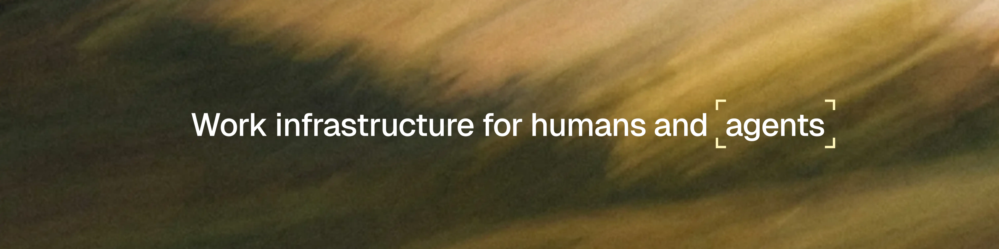

    <picture>
      <source media="(prefers-color-scheme: dark)" srcset="./assets/banner.png" />
      
    </picture>

  <em>Mid-Level Backend Engineer · Tech Content Creator</em>

  <code>TypeScript</code> • <code>Elysia.js</code> • <code>Next.js</code> • <code>PostgreSQL</code> • <code>Redis</code> 
  <code>AWS S3</code> • <code>Docker</code> • <code>BullMQ</code> • <code>CI/CD</code> • <code>Distributed Systems</code>

  <a href='https://www.instagram.com/ocastrogusttavo/'>Instagram</a>  • 
  <a href='https://www.linkedin.com/in/castrogusttavo/'>LinkedIn</a> • 
  <a href='mailto:castrogusttavo.dev@gmail.com'>E-mail</a> • 
  <a href='https://castrogusttavo-dev.vercel.app/'>Site</a>

---

### About me

- +3 years building multi-tenant SaaS and messageing platforms at:
  - **Stratus Telecom**: home of Steel, a ServiceDesk, CRM and WhatsApp platform with 6,000+ users.
  - **Adaptworks**: Brazil's SAFE® pioneer, 8,000+ professionals trained.
- I write about backend, system design and AI on [LinkedIn](https://www.linkedin.com/in/castrogusttavo/) and on my [blog](https://castrogusttavo-dev.vercel.app/writing) 
- Open to backend roles in Brazil, or remote with international teams

---

### Working on something new every week!

1. [Nexo](https://github.com/castrogusttavo/nexo) - AI-native project management. Open-source Linear/Jira alternative.
2. [AppSec - LPA2v](https://github.com/castrogusttavo/lpa2v-appsec) - Paraconsistent neural cluster for AppSec triage (SAST/SCA/DAST).
3. [Writer](https://github.com/castrogusttavo/writer-computer) - Local-first markdown editor.
4. [Steel](https://homologacao.stratustelecom.com.br) - ServiceDesk, CRM, communication and AI in one platform.
5. [Steel CLI](https://github.com/steel-so/steel-cli) - CLI and TypeScript SDK for Steel.
6. [GHP - Language](https://github.com/GHP-GoLang-Framework/ghp) - Go framework that turns PHP-style templates into HTTP handlers.
7. [Lumen IDE](https://github.com/castrogusttavo/lumen-text) - Lightweight Rust code editor for Linux, built for low RAM and TypeScript.

  <a href="https://commit-history.com/castrogusttavo">
    <picture>
      <source media="(prefers-color-scheme: dark)" srcset="https://commit-history.com/embed/castrogusttavo?theme=dark" />
      
    </picture>
  </a>

